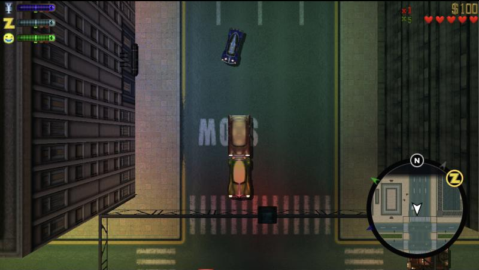
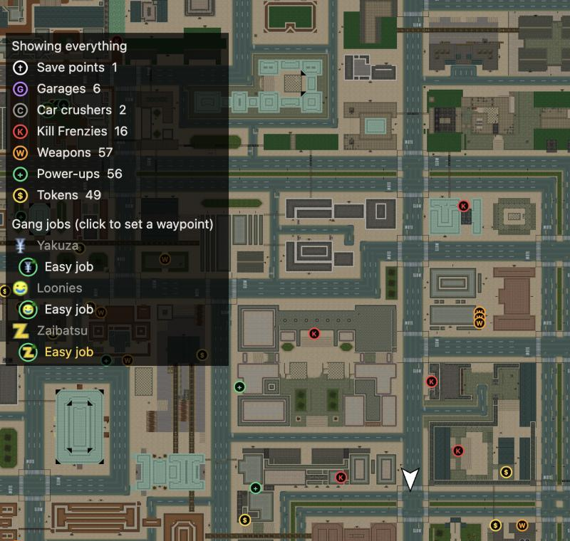

# GTA2 in your browser

**Grand Theft Auto 2 (1999), the real game, in a browser tab.** No install and no plugins.
Click Play and you're stealing a Z-Type in Downtown Anywhere City about a minute later.
Bring friends: co-op, Gang Wars and free-for-all, browser to browser.

### ▶ [Play now: m1stermo.github.io/gta2](https://m1stermo.github.io/gta2/)



The first time you press Play, the page downloads the official 2004 freeware release of GTA2
from the [Internet Archive](https://archive.org/details/gta2_rockstar-classics). That's about
346 MB, roughly half a minute on a fast connection. The page unpacks it right in the browser and
keeps it, so every visit after that starts instantly. Saves stay in your browser too, with
export and import.

Works in desktop Chrome, Edge, Firefox and Brave. Safari and phones are untested.

## What's in it

It's not a remake. The engine is the community's matching decompilation of the original code
([`gta2_re`](https://github.com/CriminalRETeam/gta2_re)), compiled to WebAssembly. Missions,
gangs, cops, radio and all three districts play the way they did in 1999.

On top of that:

- **Widescreen:** 16:9 by default, any shape you like. You see more of the city at the
  sides, and nothing pops in at the edges.
- **A camera that doesn't make you seasick.** The original's zoom pumped on every bump.
  Modern mode calms it down (Classic is one click away). **View distance** (− / =) lets you see
  further ahead.
- **A real map (M):**
  - fills in as you explore;
  - shows gang jobs you can take right now, weapons, kill frenzies, garages and save points;
  - click anywhere to drop a waypoint.
- **A GTA-style round radar** with your waypoint and the gang arrows on the rim.
- **Smooth on any screen:** 60, 120 or 165 Hz, interpolated between the original's 30 ticks.
  The game logic still runs at 30.
- **Multiplayer for up to 6.** See [below](#play-with-friends).



## Controls

| Do this | Key |
|---|---|
| Walk / drive | W A S D |
| Shoot / punch | L |
| Get in or out of a car | Enter |
| Jump / handbrake | Space |
| Previous / next weapon | J / K |
| Horn, car extras | I / O |
| Status | P |
| Map and waypoints | M |
| Scoreboard / chat (multiplayer) | Tab / T |
| View distance | − / = |

A controller works too (DualSense, DualShock 4, Xbox; press a button once so the browser
sees it): left stick or d-pad to move, R2 / L2 accelerate and brake, ✕ shoot, △ get in or
out, □ jump / handbrake, ○ horn, L1 / R1 weapons, Create the map, Options pause. In menus ✕
confirms and ○ goes back.

You can rebind any of them in the game under Options → Controls. Screen shape, camera, HUD and
the other options are on the [front page](https://m1stermo.github.io/gta2/#options).

## Play with friends

Press **Play with friends**, host a room and send your friends the link. Everyone runs the full
game, and only key presses travel between you: GTA2's own lockstep multiplayer, rewired for the
web.

- **Free roam.** Up to 6 of you loose in a story district. Friendly fire is the host's call.
- **Gang Wars.** Form crews and side with one of the district's street gangs.
  - Your gang's members leave you alone; the rival gangs and their turf attack on sight.
  - No friendly fire inside your crew.
  - The crew with the most cash (points) wins.
  - Pull up in one car: your crew-mates get in as passengers instead of carjacking you.
    Then all pile out at once.
- **Free-for-all.** GTA2's own frag game: every player for themselves, with a kill limit and
  a timer.
- **Plus:**
  - text chat (T) and a live scoreboard (Tab);
  - shared waypoints;
  - an instant rematch with the same settings.

On the public site, browsers connect directly to each other (WebRTC). How it all works, its
limits, and ideas for making it better are in **[docs/multiplayer.md](docs/multiplayer.md)**.

## Host your own

Pick whichever suits you.

### 1. Your own copy on GitHub Pages (2 minutes, free)

The public site is a plain static page with no game files in it. Each player's browser fetches
GTA2 from the Internet Archive.

1. Fork [**M1sterMo/gta2**](https://github.com/M1sterMo/gta2).
2. In your fork, open **Settings → Pages** and pick *Deploy from a branch*, `main`, `/ (root)`.
3. A minute later it's live at `https://<you>.github.io/gta2/`.

The same files work on any static host: Netlify, Cloudflare Pages, or your own nginx. Just
serve the folder as is; `config.json` (`{"static": true}`) is what switches on the Internet
Archive download.

### 2. Build it from source

You need Python 3, git and the [Emscripten SDK](https://emscripten.org) 6.0.12. Install the
SDK inside the project at `research/toolchains/emsdk`.

```sh
git clone https://github.com/emscripten-core/emsdk research/toolchains/emsdk
research/toolchains/emsdk/emsdk install 6.0.12 && research/toolchains/emsdk/emsdk activate 6.0.12
git clone https://github.com/CriminalRETeam/gta2_re research/gta2_re   # build_port.py pins it at 02de8be
git clone https://github.com/twogood/unshield research/toolchains/unshield && git -C research/toolchains/unshield checkout 0d1e7cb
python3 scripts/build_port.py --preset release --prepare    # applies port/patches and builds
python3 scripts/serve_port.py --preset release --port 8765  # http://127.0.0.1:8765/
python3 scripts/build_pages.py                             # the static site, in build/pages
```

The dev server asks for your own GTA2 folder (the one with `data/` in it). `--dev-data`
serves an installed copy from `game/` instead, on this computer only.

### 3. A private game server for your group

`server/` is a small Node server (one Docker container, about 50 MB of RAM). It gives you
things the static site can't:

- **A relay for multiplayer**, so it connects on every network, including strict NATs and
  office Wi-Fi where WebRTC fails.
- **A password, and invite links** that log friends straight in.
- **Saved crews:** Gang Wars results, reputation and a crew leaderboard.
- **Game files served from your server**, if you choose to.

```sh
mkdir -p db && chmod 777 db   # the container's user saves crews here
docker run -d --name gta2 -p 8790:8790 \
  -e GTA2_PASSWORD='pick-one' -e PUBLIC_URL=https://gta2.example.com \
  -v "$PWD/site:/srv/web:ro" -v "$PWD/game:/srv/game:ro" -v "$PWD/db:/srv/db" \
  ghcr.io/m1stermo/gta2-server:latest
```

- `site/` is the built game: a clone of [M1sterMo/gta2](https://github.com/M1sterMo/gta2), or
  `build/port/release`.
- `game/` is an installed GTA2 folder.
- Put HTTPS in front of it (Caddy or nginx).
- The invite link is in `docker logs gta2`.

Every setting and our own deploy are in [deploy/README.md](deploy/README.md).

> GTA2 is freeware but not freely redistributable. Keep a server that hosts game files
> private, behind its password, for people you know. Don't put the game files in a repo or
> on a public page.

## Contributing

PRs are welcome, especially for multiplayer. [docs/multiplayer.md](docs/multiplayer.md#ideas-for-prs)
has a list of ideas with pointers to where each one starts in the code.

| Path | What's there |
|---|---|
| `web/` | The page: landing page, lobby, WebGL2 renderer, Web Audio, map, radar, chat, saves |
| `port/platform`, `port/render`, `port/audio` | Browser stand-ins for Windows, Direct3D, DirectInput, Miles and the network layer |
| `port/patches/` | Changes to the `gta2_re` engine, as a patch series (all under `GTA2_PORT`) |
| `server/` | The optional game server: relay, password, saved crews |
| `scripts/` | Build, dev server, static site, deploy |
| `docs/` | How things work, findings and decisions ([status](docs/browser-build-status.md)) |

## Credits and legal

- **GTA2** is © Rockstar Games / Take-Two Interactive. This is an unofficial, non-commercial fan
  project, not affiliated with either. **This repository contains no game files.** Players get
  the official freeware release from the Internet Archive, or use their own copy.
- **The engine** comes from the [`gta2_re`](https://github.com/CriminalRETeam/gta2_re)
  decompilation by the CriminalRETeam contributors, applied here as patches. Their terms apply
  to those patches.
- Also used: [`unshield`](https://github.com/twogood/unshield) (MIT, unpacks the installer),
  [Trystero](https://github.com/dmotz/trystero) (MIT, peer-to-peer co-op) and
  [Emscripten](https://emscripten.org).
- **This port** was built with Claude (Anthropic) in Claude Code. The
  [build log](docs/benchmark-report.md) has the story. Our own code is MIT-licensed (see
  `LICENSE`).
